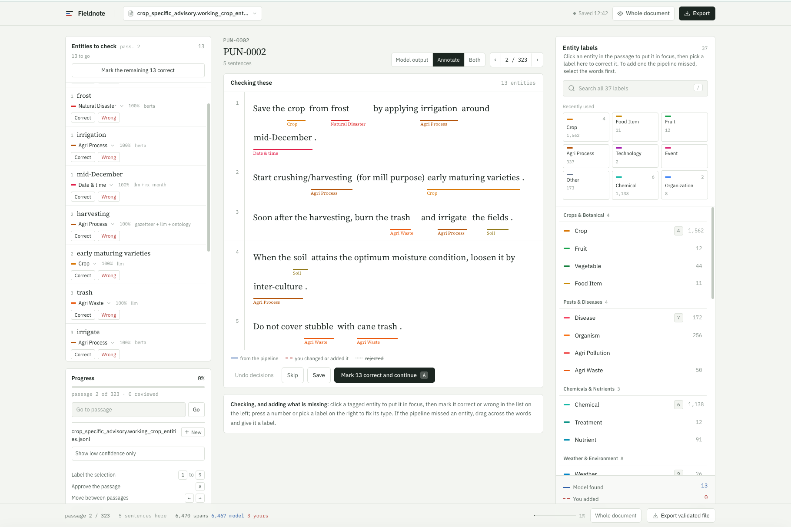

# AgNER: Agricultural Named Entity Recognition & Human-in-the-Loop Annotation Suite

**A workbench for annotating NER data by hand**, for agricultural advisories,
pest and disease reports and agronomic research documents. A person reads a
passage and marks which words are entities and what type each one is; what comes
out is a labelled dataset — training data, and a gold benchmark to measure
against.

The annotation is the product. **A fine-tuned RoBERTa-base checkpoint
(AgNER-BERTa) is there to assist it**, pre-marking what it thinks are entities
so the annotator corrects rather than starts from an empty page. That is the
whole of its role: it can be declined outright when a file is opened, it never
runs on a file that is already tagged, and a span it proposed carries
`verified: false` however confident it was — only a person's sign-off makes a
label data. Where the model and the annotator disagree, the annotator is right
by definition, and the export keeps the two readings apart so nothing downstream
can confuse them.

Because the model is an assistant rather than a gate, it runs **on demand** a
window ahead of the annotator, and a large file is ready to work on the moment
it is uploaded.



> **New to the application, or going to annotate with it?** Start with
> **[Introduction and Annotator's Guide](USER_GUIDE.md)** — what it is for, every
> panel on the screen, what each mark and colour means (solid, dashed, dotted),
> annotating, validating pipeline output, the keys, saving, how to read the
> exported file, and what to do when something looks wrong.
> This README covers the architecture, the API and deployment.

---

## Architecture Overview

```
NERPROJECT/
├── NER-roberta-base_512/      # Fine-tuned RoBERTa token classification checkpoint
├── NER-App/
│   ├── frontend/              # React 18 + Vite + Tailwind CSS (passage annotation workbench)
│   ├── backend/               # Node.js + Express + Mongoose (REST API & Persistence)
│   ├── python-ai-service/     # FastAPI + PyTorch + Hugging Face Transformers
│   ├── Dockerfile             # Unified production container (Node + FastAPI + PyTorch)
│   └── start.sh               # Container orchestration & startup script
└── README.md
```

---

## Key Capabilities

### 1. Document Ingestion (`.jsonl` passage files, `.json`, and more)
* **A `text` field is the only requirement.** One JSON object per line with a
  `text` field is enough to start annotating. Anything else the file carries is
  used if present and ignored if not.
* **Advisory passage files, first class.** Files from the passage/header
  extraction pipeline are read directly, and their metadata is carried through
  to the screen and into exports:

  ```json
  {"passage_id": "3817e6a6596d", "passage_tag": "PUN-0001",
   "crops": ["WHEAT"], "stages": ["Sowing"], "subjects": ["WHEAT (Sowing)"],
   "text": "Farmers are advised to sow varieties PBW 752 ..."}
  ```

  `crops` and `stages` are shown beside the passage so the annotator can see
  what it is about; `passage_tag` identifies it. Alternative spellings
  (`crop`, `stage`, a comma-separated string) are accepted, and a passage with
  no crops or stages still annotates normally.
* **Other shapes still work**: nested advisory `sections`, `{ pages: [...] }`,
  `{ test_cases: [...] }`, flat `{"text": ...}` records, and arbitrary JSON as a
  last resort. A `.jsonl` file uploaded with a `.json` extension is detected and
  parsed line by line.

### 2. One Passage at a Time, With the Model Running Ahead
* **Annotation starts immediately.** Nothing is predicted at upload. Running the
  model over a whole file is minutes of waiting before a single passage can be
  looked at, and the annotator only ever needs the one in front of them.
* **The model stays a window ahead.** As the annotator moves, the client asks
  `POST /api/documents/:id/predict` for the current passage plus the next ten.
  A passage already predicted, skipped, or in flight is never asked for twice,
  and a window that fails can be retried from the passage itself.
* **A whole passage on screen.** Every sentence of the advisory is shown
  together, numbered down a gutter, so context is never cut in half. Spans are
  marked by underline in the label's own colour — **solid** for a machine's
  reading, **dashed** for a person's, **dotted and struck through** for one
  rejected in validation — with the label set beneath. Colour never encodes
  confidence; confidence is a number and is shown as one.
* **Either workflow, decided from the file.** Plain text is annotated;
  pipeline output is validated. See [Two Workflows](#two-workflows).
* **Three columns**: the span list on the left, the passage in the middle, the
  37 entity labels on the right.
* **Keyboard first**: <kbd>1</kbd>–<kbd>9</kbd> label the selection,
  <kbd>A</kbd> approves the passage and moves on, <kbd>←</kbd>/<kbd>→</kbd>
  move between passages (saving anything unsaved on the way out), <kbd>/</kbd>
  searches labels.
* **Writes never block a click.** An edit applies locally at once and is written
  behind the interface, one request at a time in order.

### 3. The Full Entity Palette, Always Open
* **All 37 classes visible**, grouped by domain with sticky headings in the
  right-hand column — always open and scrollable, with no hidden dropdown and no
  short list standing in for the taxonomy.
* **Recently used first.** The block above the list follows the labels the
  annotator actually reaches for, while the number keys stay fixed: the digit
  printed beside a label is always the digit that applies it.
* **Typeahead search** filters by name (<kbd>/</kbd> to focus, <kbd>Enter</kbd>
  applies the first match, <kbd>Esc</kbd> clears).
* **Select, then label.** Dragging across any words in any sentence arms a
  selection; a label then applies to it. A selection always wins over a span in
  focus, so labelling what was just dragged over is never ambiguous. A selection
  crossing two sentences, or one that cannot be placed exactly, says so instead
  of failing silently.
* **In-place editing.** Click a span to put it in focus and change its label,
  see its confidence and sources, or remove it.

### 4. One Export, Which Is Also the Save File
* **One button, one file.** The interface exports the uploaded file with the
  annotations appended — `annotated_<date>_<time>.jsonl`, or
  `validated_<date>_<time>.jsonl` for a validation document. No format picker,
  and no separate gold export to keep in step: `verified` tells a consumer which
  spans a person stands behind. The shape is under
  [Annotation Output](#annotation-output).
* **It writes before it reads.** Both export buttons flush the passage on screen
  and wait for the save queue to drain before asking the server to build the
  file, so work that has not been written yet cannot be missing from it.
* **Re-uploadable.** An exported file is the working copy: upload it again and
  the annotations come back with their provenance, and those passages are not
  queued for the model a second time.
* **Derivatives on the same endpoint** for pipelines that want them —
  `?format=conll|hf|spacy|jsonl|json|manifest`. These are not surfaced in the
  interface.
* **Counts are read from the file itself**, not from response headers a browser
  may hide, so the note under the top bar always matches what was saved.

### 5. Entity Provenance: Whose Reading Is This?
Every span records where it came from and whether a person has signed it off.

* **Annotation documents** carry `source` (`model` or `human`), `status`
  (`accepted`, `approved`, `edited`), `confidence`, and **`verified`**, which is
  true only where a person approved, edited or added the span. `verified` is the
  field a training set and a benchmark both turn on; `status: "accepted"` means
  only that the model cleared its threshold and nobody has looked.
* **Validation documents** carry the pipeline's own `score` and `sources`
  untouched, plus a `validation` block holding the decision a person recorded —
  `confirmed`, `rejected`, `relabelled` (with `original_type`) or `added` (a
  span the pipeline missed, `sources: ["human"]`). An entity nobody has judged
  carries no block at all, which is what lets a part-finished file be resumed.
* **`Agri_Equipment` can only come from a person.** It joined the taxonomy after
  the checkpoint was trained, so the model cannot predict it; the manifest
  records it under `annotator_only_labels`.
* The older `GET /:id/training-data` endpoint emits the legacy
  `tag: NER_LABELLED | MANUALLY_LABELLED`, `labelled_by` and `labelled_summary`
  fields instead. It is kept for compatibility and is not what the interface
  produces.

### 6. Persistence That Never Blocks a Click
* **Passage-level save (`PUT .../segments/:i/entities`)**, applied optimistically
  and written behind the interface, one request at a time and in order, so no
  edit waits for the network and two writes can never land out of sequence.
* **Approving, saving, moving passage and exporting all write.** The browser
  warns before a close or reload with a write in flight or unsaved changes on
  screen.
* **Reset (`POST .../segments/:i/reset`)** restores a passage from its immutable
  `originalEntities` — the model's own reading, or the pipeline's — without
  touching any other passage.
* **Validation writes are checked server-side**: a decision must belong to a
  span the file supplied, and an added span's offsets must really describe its
  text in that passage, or it is refused and counted.
* Line-level endpoints (`PUT .../line-entities`, `POST .../reset-line`) remain
  for compatibility; the passage view no longer uses them.

---

## 37 Canonical Agricultural Entity Classes

The annotation interface offers 37 standardized classes across 7 functional
domains. The model predicts 36 of them: `Agri_Equipment` was added after the
checkpoint was trained, so the model never proposes it and it reaches a dataset
only when an annotator applies it. Exports declare this in the manifest as
`annotator_only_labels`, with `model_labels` listing what the checkpoint can
actually emit.

| Domain | Entity Classes | Typical Examples |
| :--- | :--- | :--- |
| **Crops & Agriculture** | `Crop`, `Fruit`, `Vegetable`, `Food_Item`, `Soil` | Wheat, Maize, Basmati Rice, Sandy Loam, Clay Soil |
| **Pests & Pathology** | `Disease`, `Organism`, `Agri_Pollution`, `Agri_Waste` | Yellow Rust, Aphids, Whitefly, Stubble Burning, Rice Straw |
| **Treatments & Inputs** | `Chemical`, `Treatment`, `Nutrient` | Urea, Imidacloprid, Fungicide Spray, Nitrogen, Potash |
| **Meteorology & Climate**| `Weather`, `Rainfall`, `Temp`, `Humidity`, `Season`, `Natural_Disaster`, `Natural_Resource` | Monsoon, Frost, 28°C, 85% RH, Kharif, Drought, Groundwater |
| **Quantities & Time** | `Quantity`, `Other_Quantity`, `Field_Area`, `Duration`, `Money`, `Date_and_Time`, `Event` | 50 kg/ha, 2.5 acres, 15 days, ₹1200, October 15, Sowing |
| **Entities & Agents** | `Person`, `Organization`, `Location`, `Policy` | PAU Ludhiana, ICAR, Punjab, PM-KISAN, Extension Officer |
| **Methods & Technology** | `Agri_Equipment`, `Agri_Method`, `Agri_Process`, `Technology`, `ML_Model`, `Citation`, `Other` | Happy Seeder, Super Seeder, Rotavator, Drip Irrigation, Tillering, Tensiometer, AgNER-BERTa |

---

## Legacy Export Shapes

These come from the older `GET /:id/training-data` and `GET /:id/label-studio`
endpoints, kept so existing consumers keep working. **They are not what the
interface exports** — for that, see [Annotation Output](#annotation-output).

### 1. Training Data (`.json` or `.jsonl`)
```json
{
  "document": "punjab_wheat_advisory.jsonl",
  "segmentIndex": 0,
  "lineIndex": 1,
  "text": "Wheat crop requires nitrogen fertilizer at tillering stage, but watch for yellow rust.",
  "entities": [
    {
      "text": "Wheat",
      "label": "Crop",
      "start": 0,
      "end": 5,
      "tag": "NER_LABELLED",
      "labelled_by": "NER Model",
      "source": "model",
      "status": "accepted",
      "confidence": 0.9842
    },
    {
      "text": "nitrogen fertilizer",
      "label": "Chemical",
      "start": 19,
      "end": 38,
      "tag": "MANUALLY_LABELLED",
      "labelled_by": "Manual Annotator",
      "source": "human",
      "status": "approved",
      "confidence": 1.0
    },
    {
      "text": "yellow rust",
      "label": "Disease",
      "start": 74,
      "end": 85,
      "tag": "NER_LABELLED",
      "labelled_by": "NER Model",
      "source": "model",
      "status": "accepted",
      "confidence": 0.9415
    }
  ],
  "labelled_summary": {
    "ner_labelled_count": 2,
    "manually_labelled_count": 1,
    "total_entities": 3
  }
}
```

### 2. Label Studio Export (`.json`)
```json
[
  {
    "id": 1,
    "data": {
      "text": "Wheat crop requires nitrogen fertilizer...",
      "segment_index": 0,
      "page": 1,
      "section": "Crop Specific Advisory",
      "filename": "punjab_wheat_advisory.jsonl"
    },
    "predictions": [
      {
        "model_version": "AgNER-BERTa",
        "result": [
          {
            "id": "pred_0_0",
            "from_name": "label",
            "to_name": "text",
            "type": "labels",
            "value": { "start": 0, "end": 5, "text": "Wheat", "labels": ["Crop"] },
            "score": 0.9842,
            "tag": "NER_LABELLED",
            "labelled_by": "NER Model"
          }
        ]
      }
    ],
    "annotations": [
      {
        "result": [
          {
            "id": "ann_0_0",
            "from_name": "label",
            "to_name": "text",
            "type": "labels",
            "value": { "start": 0, "end": 5, "text": "Wheat", "labels": ["Crop"] },
            "score": 0.9842,
            "tag": "NER_LABELLED",
            "labelled_by": "NER Model"
          },
          {
            "id": "ann_0_1",
            "from_name": "label",
            "to_name": "text",
            "type": "labels",
            "value": { "start": 19, "end": 38, "text": "nitrogen fertilizer", "labels": ["Chemical"] },
            "score": 1.0,
            "tag": "MANUALLY_LABELLED",
            "labelled_by": "Manual Annotator"
          }
        ]
      }
    ]
  }
]
```

---

## Two Workflows

The platform decides which workflow a file belongs to **from the file's own
structure**, never from its name, when the file is uploaded.

| | Annotation | Validation |
| :--- | :--- | :--- |
| Triggered by | any file whose entities use `label`, or that has none | entities that use `type` with offsets, as the hybrid pipeline writes them |
| The model | predicts on demand, a window ahead of the annotator | **never runs**; `POST /:id/predict` refuses with 409 |
| The job | mark up entities | confirm, reject or relabel what the pipeline produced, and add what it missed |
| Adding entities | yes | yes, recorded as `status: "added"` and kept apart from the pipeline's own spans |
| Export | `annotated_<timestamp>.jsonl` | `validated_<timestamp>.jsonl` |

Because classification happens on the server, the file is uploaded first and the
model question is asked afterwards — and only for an annotation document.

### Validating pipeline output

A file from the hybrid pipeline carries its entities with `type`, `start`, `end`,
`score` and `sources`, alongside `bio`, `hybrid`, `suppressed` and `n_entities`.
All of it is loaded as it is and preserved; the annotator judges each entity.

Each decision is recorded against the entity it belongs to:

```json
{
  "text": "mid-December", "type": "Date_and_Time", "start": 21, "end": 33,
  "score": 0.72, "sources": ["llm"],
  "validation": { "status": "relabelled", "original_type": "Duration" }
}
```

* `status` is one of `confirmed`, `rejected`, `relabelled` or `added`. An entity
  nobody has judged carries **no** `validation` block at all, which is what lets
  a part-finished file be picked up again.
* An **added** entity is one the pipeline missed and a person marked. It is
  appended after the pipeline's own list, so nothing the pipeline wrote moves,
  and it carries `score: 1.0`, `sources: ["human"]` and no `mean_logprob` or
  `runner_up_token` — those describe a model's uncertainty, and there is none
  here. On re-import it is restored as an addition and deliberately left **out**
  of the baseline the interface compares against, so it is never mistaken for
  something the pipeline proposed. An addition is removed rather than rejected:
  rejecting one's own span records nothing useful.
* An addition may **overlap** a pipeline entity. Both are kept in the validated
  file, because they are two readings of the same words; a training export
  resolves the overlap in favour of the span a person stands behind, counted as
  `overlaps_removed`.
* `n_entities` is left exactly as the pipeline wrote it, additions and all. The
  current total is `validation_summary.entities`.
* A **rejected** entity is kept, never deleted — "the pipeline tagged this and a
  person disagreed" is the most valuable signal in the file. It is struck
  through in the interface and can be restored.
* **A rejected entity is excluded from every training-shaped export**, including
  `?low_confidence=1`, and the manifest counts the exclusions as
  `rejected_excluded`.
* `confirmed`, `relabelled` and `added` entities count as human-verified, so
  `?verified=1` yields exactly the spans a person signed off.
* Each record gains a `validation_summary` with counts and a `complete` flag. A
  passage the pipeline found nothing in needs an explicit acknowledgement, which
  appears as `nothing_to_validate`, so an unopened passage is never mistaken for
  a checked one.
* `bio`, `hybrid`, `suppressed` and `n_entities` pass through untouched as the
  historical record of the pipeline run. **After a relabel, `bio` no longer
  agrees with the validated types and is not authoritative.**

A validated file can be uploaded again to carry on: decisions and
acknowledgements come back, and the model is still never run on it.

One limitation worth knowing: JSON has no negative zero, so a `mean_logprob` of
`-0.0` comes back as `0`. The value is numerically identical and no JSON writer
can preserve the sign.

---

## Annotation Output

`GET /api/documents/:id/dataset` gives back **the file you uploaded, with the
annotations appended**. One line per record, the same records in the same order,
every original field untouched and in its original order, with two fields added
at the end:

```json
{
  "passage_id": "3817e6a6596d", "passage_tag": "PUN-0001",
  "crops": ["WHEAT"], "stages": ["Sowing"], "subjects": ["WHEAT (Sowing)"],
  "n_subjects": 1, "n_crops": 1, "n_occurrences": 13, "n_chars": 1059,
  "text": "Farmers are advised to sow varieties PBW 752 ...",

  "entities": [
    { "start": 37, "end": 44, "label": "Other", "text": "PBW 752",
      "source": "human", "verified": true,  "status": "approved", "confidence": 1 },
    { "start": 108, "end": 113, "label": "Crop", "text": "wheat",
      "source": "model", "verified": false, "status": "accepted", "confidence": 0.93 }
  ],
  "annotation": {
    "spans": 2, "model_spans": 1, "human_spans": 1, "verified_spans": 1,
    "reviewed": true, "ner_status": "done"
  }
}
```

* **Offsets are character offsets into that record's own `text`**, verified
  against it on the way out. A span whose text does not match the characters at
  its offsets is realigned only on an exact nearby match and otherwise dropped
  and counted, never emitted misaligned.
* **`source` and `verified` separate judgement from confidence.** `source` says
  who proposed the span; `verified` is true only where a person approved, edited
  or added it. `status: "accepted"` means the model cleared its threshold and
  nobody has checked it. Filter on `verified` to get a gold set — one file
  serves both training and benchmarking.
* **`Agri_Equipment` never appears from the model.** It was added to the
  taxonomy after the checkpoint was trained, so it only ever carries
  `"source": "human"`. The manifest's `annotator_only_labels` says so.
* **`ner_status`** says whether the model ever read that passage (`done`,
  `pending`, `skipped`), so an unannotated record is never mistaken for one with
  genuinely no entities.
* **Every record is present**, including passages with no entities at all
  (`"entities": []`). Those are the negative examples a model needs.
* **Overlapping spans are resolved** (verified first, then longer, then higher
  confidence), since overlaps cannot be expressed in BIO.
* Counts come back as `X-Dataset-Rows`, `X-Dataset-Entities`,
  `X-Dataset-Verified-Entities` and `X-Dataset-Quality` headers.

### The file is the working copy

An exported file can be **uploaded again to carry on where it was left off**.
Its `entities` are restored as annotations, their provenance intact, and those
passages are not queued for the model a second time. Spans that no longer match
the text they claim are dropped on the way in, so an edited file cannot corrupt
the annotation.

### Derivatives, for pipelines that want them

The same endpoint will also emit sentence-level shapes via `?format=`:
`conll` (token/tag), `hf` (tokens plus BIO tag ids; read the mapping from the manifest's
`bio_label_to_id` rather than hardcoding it, since ids shift when the taxonomy
changes), `spacy`, `jsonl`/`json` (one row per sentence) and `manifest`
(counts, labels, provenance, quality). These are not in the interface — the
export button produces the annotated file and nothing else.

---

## API Reference

### Document Management
* `POST /api/documents` — Upload a `.json` or `.jsonl` document, classify the workflow from its structure, parse it into passages, and save to MongoDB. Inference is **not** run here; annotation passages start as `pending` and are predicted on demand, while a validation file's passages are `provided` and never predicted (`?skipNer=true` marks them `skipped` to annotate from scratch).
* `POST /api/documents/:id/skip-inference` — Annotate from scratch: marks every pending passage `skipped`. Refused for a validation document.
* `POST /api/documents/:id/segments/:segmentIndex/nothing-to-validate` — Records that a person read a passage holding no entities. Refused if the passage has entities.
* `GET /api/documents` — List uploaded documents with entity statistics.
* `GET /api/documents/:id` — Retrieve document details, segments, and annotations.
* `DELETE /api/documents/:id` — Delete document and all annotations.

### Inference
* `POST /api/documents/:id/predict` — Run the model over a window of passages.
  Body is `{ "indexes": [0, 1, 2] }` or `{ "from": 0, "count": 10 }` (capped at
  25 per request). Only passages that are `pending` or previously `error` are
  run, so repeat calls are free, and a passage already annotated by hand is
  never overwritten. Replies with just the predicted passages, never the whole
  document.

### Annotation Operations
* `PUT /api/documents/:id/segments/:segmentIndex/line-entities` — Save/update entities for a specific sentence.
* `POST /api/documents/:id/segments/:segmentIndex/reset-line` — Revert a single sentence back to original model predictions.
* `PUT /api/documents/:id/segments/:segmentIndex/entities` — Batch save/update entities for an entire segment.
* `POST /api/documents/:id/segments/:segmentIndex/reset` — Reset full segment to original model output.
* `PATCH /api/documents/:id/segments/:segmentIndex/entities/:entityId` — Update individual entity status or label.

### Dataset Export
* `GET /api/documents/:id/dataset` — The uploaded file with annotations appended. See **Annotation Output** above.
* `GET /api/documents/dataset` — The same, across every uploaded document.
* `GET /api/documents/:id/label-studio` — Download official Label Studio tasks and annotations JSON.
* `GET /api/documents/:id/training-data` — Earlier export format, unchanged for compatibility. Note that it omits sentences without entities and does not distinguish human-verified spans from confident model output.
  * Query parameters:
    * `format=lines`: Exports sentence-by-sentence dataset.
    * `as=jsonl`: Exports as newline-delimited JSON Lines.
    * `download=false`: Returns raw JSON response for API integrations.

---

## Local Development Setup

### Prerequisites
* **Node.js** v18+ and `npm`
* **Python** 3.10+ with `pip`
* **MongoDB** (local community edition or MongoDB Atlas URI)

### 1. Environment Configuration
Create `NER-App/backend/.env`:
```env
PORT=5000
MONGO_URI=mongodb+srv://<username>:<password>@cluster0.mongodb.net/ner_annotation
AI_SERVICE_URL=http://127.0.0.1:8000
CONFIDENCE_THRESHOLD=0.75
```

### 2. Run All Services Concurrently
From `NER-App/`:
```bash
npm run dev:all
```
This simultaneously starts:
* **Python AI Service**: `http://127.0.0.1:8000`
* **Express Backend**: `http://localhost:5000`
* **Vite Frontend**: `http://localhost:5173`

Or run separately across 3 terminals:
* **Terminal 1 (AI Service)**:
  ```bash
  cd NER-App/python-ai-service
  pip install -r requirements.txt
  python -m uvicorn app:app --port 8000
  ```
* **Terminal 2 (Backend)**:
  ```bash
  cd NER-App/backend
  npm install
  npm run dev
  ```
* **Terminal 3 (Frontend)**:
  ```bash
  cd NER-App/frontend
  npm install
  npm run dev
  ```

---

## Production Deployment & Stability Optimizations

The system is containerized via a **unified single-container Dockerfile** (`NER-App/Dockerfile`) running both the Node.js backend and FastAPI AI service, optimized for cloud platforms like **Railway.app**:

1. **PyTorch CPU Optimization**:
   * Thread pool throttled via `torch.set_num_threads(2)` and `torch.set_num_interop_threads(1)` to eliminate vCPU contention in container environments.
   * Model inference switched to `@torch.inference_mode()` for lower memory consumption.
2. **Micro-Batching**:
   * Segment inference is processed in chunks of 5 segments, ensuring execution times stay well under reverse proxy 60-second timeouts to prevent `502 Bad Gateway` errors.
3. **Hardened CORS**:
   * Configured with dynamic origin reflection (`origin: true`), global preflight handling (`app.options('*')`), and error-middleware header persistence so cross-origin requests from frontends never drop `Access-Control-Allow-Origin`.

---

## Label Studio Integration Guide

To import annotated datasets into Label Studio:
1. Review and annotate passages in the workbench.
2. Fetch `GET /api/documents/:id/dataset?format=jsonl` (the Label Studio task format is at `/:id/label-studio`).
3. Open Label Studio, create a new project, and configure the labeling interface:
   ```xml
   <View>
     <Labels name="label" toName="text">
       <Label value="Crop" background="#10B981"/>
       <Label value="Chemical" background="#14B8A6"/>
       <Label value="Disease" background="#F43F5E"/>
       <Label value="Treatment" background="#06B6D4"/>
       <Label value="Nutrient" background="#0EA5E9"/>
       <Label value="Location" background="#6366F1"/>
       <Label value="Quantity" background="#8B5CF6"/>
       <Label value="Weather" background="#38BDF8"/>
     </Labels>
     <Text name="text" value="$text"/>
   </View>
   ```
4. Click **Import** in Label Studio and upload the downloaded file. Both model pre-annotations and manual human tags will load with character-exact offsets.
